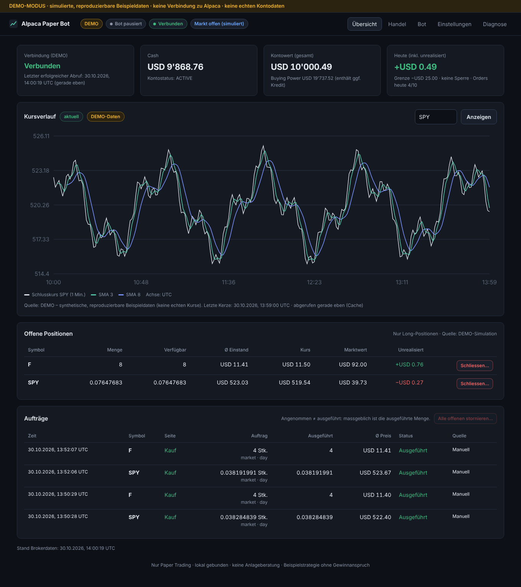
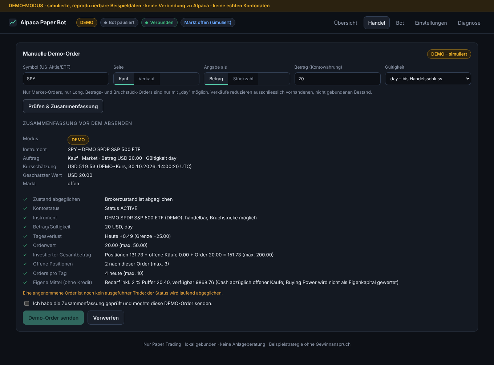
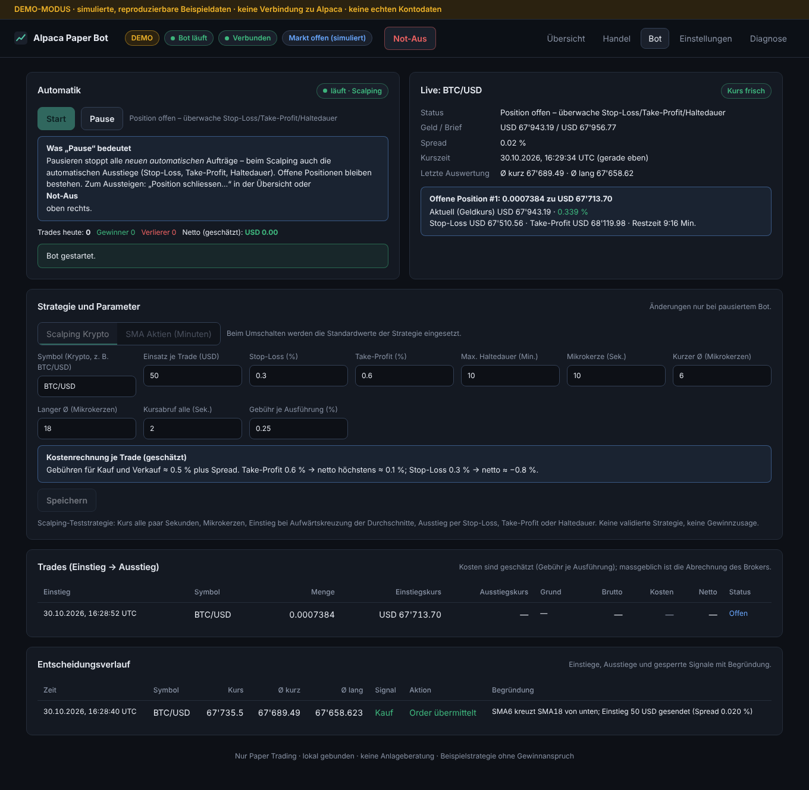

# Alpaca Paper Bot

Privater Trading-Bot mit Weboberfläche für das **Alpaca-Paper-Konto** (Spielgeld). Erste, bewusst überschaubare Version.

* **Nur Paper Trading.** Handelsanfragen gehen ausschliesslich an `https://paper-api.alpaca.markets`, Marktdaten ausschliesslich an `https://data.alpaca.markets`. Einen Echtgeldmodus oder eine frei einstellbare Broker-URL gibt es nicht. Das Backend prüft die Zieladressen und folgt keinen Redirects.
* **Zwei ausdrücklich gewählte Betriebsarten:** `DEMO` (lokale, reproduzierbare Beispieldaten, simulierte Orders, kein Alpaca-Zugriff) und `PAPER` (Ihr echtes Alpaca-Paper-Konto). Die Anwendung startet immer in `DEMO`, mit pausiertem Bot und gesperrter Paper-Orderfreigabe.
* **Keine Zugangsdaten im Frontend.** Nur das Backend authentifiziert sich bei Alpaca.
* **Zwei Teststrategien:** Scalping für Krypto (z. B. `BTC/USD`, Standard) und eine Minutenstrategie für US-Aktien/ETFs. Beide dienen **nur zum Prüfen der Automatik**. Sie sind weder validiert noch auf Gewinn ausgelegt und keine Anlageempfehlung.



---

## Inhalt

1. [Architektur](#architektur)
2. [Entwicklung und Tests in Claude Code im Web](#entwicklung-und-tests-in-claude-code-im-web)
3. [Cloud-Zugangsdaten: Network Secret einrichten](#cloud-zugangsdaten-network-secret-einrichten)
4. [Bedienung: DEMO → PAPER → manuelle Order → Automatik](#bedienung)
5. [Betrieb auf dem Windows-PC](#betrieb-auf-dem-windows-pc)
6. [Betrieb auf einem Linux-Server (mit/ohne Docker)](#betrieb-auf-einem-linux-server)
7. [Erreichbarkeit der Oberfläche](#erreichbarkeit-der-oberfläche)
8. [Risikogrenzen, Strategie und Zuverlässigkeit](#risikogrenzen-strategie-und-zuverlässigkeit)
9. [Typische Fehler](#typische-fehler)
10. [Prüfstand dieser Version](#prüfstand-dieser-version)

---

## Architektur

```
frontend/  React 19 + TypeScript + Vite   →  dunkle deutsche UI, ruft nur /api auf (gleiche Origin)
backend/   Python 3.11+ · FastAPI · Pydantic · httpx · SQLite
  app/broker/alpaca.py   gemeinsamer REST-Adapter (Auth-Modus proxy | env, feste Hosts, Timeouts, Backoff)
  app/broker/demo.py     simulierter Broker für DEMO (gleiche Schnittstelle)
  app/runtime.py         Abgleich mit dem Broker (Konto, Positionen, Orders, client_order_id)
  app/orders.py          EIN Orderweg für manuelle und Bot-Orders
  app/risk.py            EINE serverseitige Risikoprüfung für alle Orderwege
  app/strategy.py        SMA-Kreuzung auf abgeschlossenen Minutenkerzen
  app/bot.py             genau eine Bot-Instanz, Start/Pause
  app/connection_check.py  separat ausführbarer Verbindungstest
```

* Speicherung: SQLite (`backend/data/alpaca-bot.sqlite3`): Konfiguration, Bot-Zustand, Aufträge, Ereignisse und Entscheidungen, jeweils getrennt nach `DEMO`/`PAPER`.
* Lockfiles: `backend/uv.lock` (plus `backend/requirements.txt` mit Hashes für pip/Docker) und `frontend/package-lock.json`.
* Ein Backend-Prozess (Dateisperre neben der Datenbank). Standardmässig nur an `127.0.0.1` gebunden. Kein CORS, Origin- und CSRF-Prüfung für ändernde Aufrufe, Host-Header-Prüfung gegen DNS-Rebinding.

---

## Entwicklung und Tests in Claude Code im Web

Claude Code im Web ist die **Entwicklungsumgebung**, nicht der Ort für den Dauerbetrieb: Die Cloud-Sitzung ist temporär und wird nach Inaktivität angehalten.

Voraussetzungen in der Cloud sind vorinstalliert (Python 3.13, `uv`, Node 22).

```bash
cd backend && uv sync && uv run pytest -q
```

```bash
cd frontend && npm ci && npm run typecheck && npm run build
```

Anwendung starten (liefert das gebaute Frontend unter derselben Adresse aus):

```bash
cd backend && ALPACA_AUTH_MODE=proxy uv run python -m app
```

Lesender Verbindungstest gegen das Paper-Konto (`GET /v2/account`, gibt nur Modus, Kontostatus, Währung, Cash und Kontowert aus):

```bash
cd backend && ALPACA_AUTH_MODE=proxy uv run python -m app.connection_check
```

Exit-Codes: `0` Erfolg · `2` Konfiguration fehlt · `3` Authentifizierung/Berechtigung · `4` Netzwerk/Timeout · `5` Rate Limit · `6` sonstiger Brokerfehler.

> Hinweis: Im Proxy-Modus setzt die Cloud die Alpaca-Header. Der Prozess sendet seine Anfragen ohne eigene Zugangsdaten über den vorkonfigurierten HTTPS-Proxy und behält dessen Zertifikatskonfiguration bei (`HTTPS_PROXY`, `SSL_CERT_FILE`, TLS-Prüfung aktiv).

---

## Cloud-Zugangsdaten: Network Secret einrichten

Grundlage ist die offizielle Dokumentation [Configure cloud environments → Add network secrets](https://code.claude.com/docs/en/cloud-environments#add-network-secrets), Stand 30.10.2026. Die Werte tragen **Sie selbst** in den Einstellungen ein. Bitte keine Schlüssel in den Chat kopieren.

**Schritte (Pro/Max bzw. Team/Enterprise mit Owner-Rolle):**

1. In [claude.ai/code](https://claude.ai/code) eine neue Sitzung öffnen → Umgebungsauswahl (erstes Bedienelement unter dem Eingabefeld) → bei Ihrer Umgebung auf das Zahnrad → Dialog **Edit cloud environment**.
2. Zeile **Network secrets** → **Add secret**.
3. **Secret type**: `Bearer` (Standard) lassen und ausfüllen:
   * **Name**: `Alpaca Paper`
   * **Allowed websites**: genau diese beiden Hosts (ohne `*.`-Platzhalter):
     ```text
     paper-api.alpaca.markets
     data.alpaca.markets
     ```
   * **Custom headers**: Die erste Zeile ist mit `Authorization` / Prefix `Bearer` vorbelegt. Ändern Sie sie zu:
     * Name `APCA-API-KEY-ID`, **Prefix leeren**, Value = Ihre Paper-Key-ID
     * zweite Zeile: Name `APCA-API-SECRET-KEY`, **Prefix leeren**, Value = Ihr Paper-Secret
4. **Add** klicken. Der Wert ist danach nicht mehr einsehbar.
5. Unter **Environment variables** (kein Geheimnis) eintragen: `ALPACA_AUTH_MODE=proxy` und mit **Save changes** speichern.
6. **Neue Sitzung starten** (bestehende Sitzungen übernehmen Variablen erst nach einem Neustart der VM) und Claude bitten: „Führe den Verbindungstest aus“.

Die Hosts eines Network Secrets sind laut Doku automatisch erreichbar, auch wenn die Netzwerkstufe sie sonst nicht erlauben würde. Eine zusätzliche Freigabe unter **Network access → Allowed domains** ist dann nicht nötig. Network Secrets werden nur an Befehle angehängt, die Claude in der Sitzung ausführt, nicht an Anfragen aus Setup-Skripten.

**Mögliche Abweichungen der Eingabemaske:**

| Situation | Was tun |
| --- | --- |
| Die Maske erlaubt nur **eine** Zeile unter *Custom headers* | Die Doku beschreibt ausdrücklich nur „eine Zeile für den Header“. Alpaca akzeptiert für Schlüsselpaare auch **HTTP Basic Auth** (Key-ID als Benutzername, Secret als Passwort). Wählen Sie dann **Secret type → Username and password** mit denselben zwei Hosts. Der Bot funktioniert unverändert, weil er im Proxy-Modus selbst keine Auth-Header sendet. |
| Team/Enterprise **ohne** Owner-Rolle (kurze Maske: ein *Host* je Secret, Typ *Token* oder *Username and password*) | Zwei Secrets vom Typ **Username and password** anlegen, eins mit Host `paper-api.alpaca.markets`, eins mit Host `data.alpaca.markets`. *Token* passt nicht, weil Alpaca kein `Authorization: Bearer` für Paper-Schlüssel nutzt. |
| Geteilte Organisations-Umgebung | Secrets kann nur ein Owner unter *admin settings → Cloud environments* anlegen. |
| Kunden-verwaltete Schlüssel (CMEK) oder self-hosted Umgebung | Network Secrets sind dort laut Doku nicht verfügbar. Den Bot dann auf dem eigenen PC/Server mit `ALPACA_AUTH_MODE=env` betreiben. |

Sicherheitsregel: Network Secrets für Alpaca nie als normale *Environment variables* hinterlegen. Diese kann jede Person lesen, die die Umgebung nutzt.

---

## Bedienung

### 1. Start im DEMO-Modus
Nach dem Start (siehe unten) `http://127.0.0.1:8000` öffnen. Oben steht dauerhaft ein gelbes **DEMO-MODUS**-Band. Konto, Kurse und Orders sind dort simuliert und reproduzierbar (10’000 USD Startkapital, Markt immer „offen (simuliert)“). Unter *Einstellungen → DEMO zurücksetzen* lässt sich das Demokonto neu aufsetzen.

### 2. Verbindung zum PAPER-Konto
1. *Diagnose → Verbindung testen*: Nur bei „Verbindung erfolgreich“ besteht wirklich eine Verbindung.
2. *Einstellungen → Betriebsart → PAPER*: Das blaue **PAPER-MODUS**-Band erscheint. Schlägt ein Abruf fehl, zeigt die Übersicht eine rote Fehlermeldung und **keine** Kontodaten. Ersatzdaten gibt es nie.

### 3. Manuelle Paper-Order
1. *Einstellungen → Paper-Orders freigeben…* (nach jedem Neustart wieder aus).
2. *Handel*: Symbol, Kauf/Verkauf, Betrag oder Stückzahl, Gültigkeit → **Prüfen & Zusammenfassung**. Die Zusammenfassung zeigt Kursschätzung, Wert und alle Prüfungen (✓/✗).
3. Bestätigungshäkchen setzen → **Paper-Order senden**. „Angenommen“ heisst noch nicht „ausgeführt“: Die Auftragstabelle zeigt Status und **tatsächlich ausgeführte Menge**.



### 4. Automatik ausdrücklich starten
*Bot*: Strategie wählen und Parameter prüfen → **Start**.

* **Scalping Krypto** (Standard, `BTC/USD`): handelt rund um die Uhr. Start nur bei gültiger Konfiguration, erfolgreichem Kontoabgleich, aktivem Brokerstatus, handelbarem Krypto-Instrument, frischem Kurs (≤ 15 s) und (PAPER) aktiver Orderfreigabe. Danach sammelt der Bot rund 3 Minuten Mikrokerzen, bevor er einsteigen kann.
* **SMA Aktien (Minuten)**: Start zusätzlich nur bei geöffneter US-Börse, regulärer Handelssitzung und frischer Minutenkerze.

**Pause** stoppt alle *neuen automatischen* Aufträge – beim Scalping also auch die automatischen Ausstiege. Offene Positionen bleiben bestehen, bereits gesendete Broker-Orders bleiben aktiv. **Stornieren**, **Position schliessen…** und **Not-Aus** sind separate, ausdrücklich ausgelöste Aktionen.

**Not-Aus** (roter Knopf oben rechts): Bot sofort pausieren, alle offenen Orders stornieren und alle Positionen per Market-Order schliessen. Im PAPER-Modus werden Positionen nur bei aktiver Paper-Orderfreigabe geschlossen; sonst werden nur die Orders storniert und das Ergebnis angezeigt.

---

## Betrieb auf dem Windows-PC

Einmalig installieren: [Python 3.12+](https://www.python.org/downloads/), [uv](https://docs.astral.sh/uv/getting-started/installation/), [Node.js 22 LTS](https://nodejs.org/) und Git.

In PowerShell:

```powershell
git clone https://github.com/johannesjwolf-coder/alpaca-bot.git
cd alpaca-bot
Copy-Item .env.example .env
notepad .env   # ALPACA_AUTH_MODE=env und Ihre PAPER-Schlüssel eintragen, speichern
```

```powershell
cd frontend; npm ci; npm run build; cd ..
```

```powershell
cd backend; uv sync --no-dev; uv run python -m app
```

Danach im Browser `http://127.0.0.1:8000` öffnen. Beenden mit `Strg+C`. Die `.env` ist per `.gitignore` von Git ausgeschlossen. Alternativ können Sie die beiden Schlüssel als Benutzer-Umgebungsvariablen setzen und auf die `.env` verzichten.

Verbindungstest auf dem PC:

```powershell
cd backend; uv run python -m app.connection_check
```

---

## Betrieb auf einem Linux-Server

### Mit Docker Compose (empfohlen)

```bash
git clone https://github.com/johannesjwolf-coder/alpaca-bot.git && cd alpaca-bot
```

```bash
cp .env.example .env && chmod 600 .env && nano .env
```

```bash
docker compose up -d --build
```

* Der Port wird nur an `127.0.0.1:8000` des Servers gebunden. Die SQLite-Datei liegt im Volume `alpaca-bot-data`.
* Zugriff vom eigenen Rechner per SSH-Tunnel (nicht öffentlich!):

```bash
ssh -L 8000:127.0.0.1:8000 benutzer@ihr-server
```

  Danach lokal `http://127.0.0.1:8000` öffnen.

### Ohne Docker (systemd)

```bash
cd alpaca-bot/frontend && npm ci && npm run build && cd ../backend && uv sync --no-dev
```

Beispiel `/etc/systemd/system/alpaca-bot.service`:

```ini
[Unit]
Description=Alpaca Paper Bot
After=network-online.target

[Service]
User=alpaca
WorkingDirectory=/opt/alpaca-bot/backend
EnvironmentFile=/opt/alpaca-bot/.env
ExecStart=/home/alpaca/.local/bin/uv run --no-dev python -m app
Restart=on-failure

[Install]
WantedBy=multi-user.target
```

**Öffentliche Bereitstellung:** nicht vorgesehen. Die Anwendung hat keine Benutzeranmeldung. Wer sie später extern erreichbar machen will, braucht bewusst eingerichtete Zugangskontrolle (z. B. Reverse-Proxy mit Login/SSO oder VPN) **und HTTPS**. Zudem müssen `APP_ALLOWED_HOSTS` und `APP_ALLOWED_ORIGINS` angepasst werden. Das Backend verweigert den Start auf einer Nicht-localhost-Adresse, solange `APP_ALLOW_NONLOCAL_BIND=1` nicht ausdrücklich gesetzt ist (nur für Container gedacht).

---

## Erreichbarkeit der Oberfläche

* **Claude Code im Web** bietet laut aktueller Dokumentation **keine Vorschau oder Portweiterleitung** für Server, die in der Cloud-Sitzung laufen. `http://127.0.0.1:8000` auf dem Cloud-Rechner ist von Ihrem PC oder Handy aus **nicht** erreichbar. In der Cloud wurde die Oberfläche deshalb mit einem Headless-Browser (Playwright) geprüft. Die Screenshots in `docs/screenshots/` stammen aus diesem Lauf (nur DEMO-Daten und Fehleranzeigen, keine Zugangsdaten).
* Um die UI selbst zu bedienen, brauchen Sie eine separate Laufumgebung: Ihren Windows-PC oder einen Linux-Server (siehe oben).
* Für die Frontend-Entwicklung mit Hot Reload (lokal): Backend starten und zusätzlich `cd frontend && npm run dev` ausführen, dann `http://127.0.0.1:5173` öffnen (Vite reicht `/api` an das Backend weiter).

---

## Risikogrenzen, Strategie und Zuverlässigkeit

### Serverseitige Grenzen (für alle Orderwege gleich, je Modus getrennt einstellbar)

| Grenze | Standard (technischer Paper-Testwert) |
| --- | --- |
| Max. Orderwert (= Grösse je Trade) | 50 |
| Max. investierter Gesamtbetrag (Positionen + offene Käufe + neue Order) | 200 |
| Max. offene Positionen | 3 |
| Max. Einstiege (Käufe) pro Stunde / pro Tag | 10 / 50 |
| Max. Orders pro Tag (Käufe + Verkäufe, Handelstag New York) | 100 (sperrt Käufe; risikoreduzierende Verkäufe bleiben erlaubt) |
| Max. Tagesverlust inkl. unrealisierter Veränderungen | 25 |
| Kaufpause nach Verlust-Trades in Folge | nach 3 Verlusten 30 Min. (Verkäufe bleiben erlaubt) |
| Max. Spread für Einstiege (Krypto) | 0,1 % |
| Kurspuffer für Market-Orders | 2 % |

* **Tagesverlust** = Kontowert jetzt − Ausgangswert des Handelstags. Ausgangswert ist Alpacas `last_equity` (Kontowert zum letzten Handelsschluss), ersatzweise der erste beobachtete Kontowert des Tages. Ohne aktuelle Kontodaten werden Käufe gesperrt. Wird die Grenze verletzt, bleiben neue Käufe **bis zum nächsten Handelstag (00:00 Uhr New York)** gesperrt, auch wenn sich der Kurs erholt. Verkäufe bleiben möglich.
* **Eigene Mittel:** Käufe nutzen nur Cash (bzw. `non_marginable_buying_power`, falls kleiner) abzüglich offener Käufe. Die *Buying Power* enthält ggf. Kredit und wird nicht als Eigenkapital gewertet.
* **Verkäufe** reduzieren nur vorhandenen, nicht durch offene Verkaufsorders gebundenen Long-Bestand. Leerverkäufe, Hebel, Derivate und Kredit sind nicht Teil dieser Version.
* **Orderregeln:** nur Market-Orders, geprüft gegen die Instrumentdaten des Brokers.
  * US-Aktien/ETFs (`us_equity`, kein OTC): Betragsorders (≥ 1, max. 2 Nachkommastellen) und Bruchstücke (max. 9 Nachkommastellen) nur für bruchstückfähige Instrumente und nur mit Gültigkeit `day`; ganze Stück auch mit `gtc`.
  * Krypto (`crypto`, nur Paare gegen USD wie `BTC/USD`): Gültigkeit immer `gtc`, Mindestmenge laut Broker, Kauf zum Brief-, Verkauf zum Geldkurs. Alpaca berechnet je Ausführung eine Gebühr.

### Scalping-Strategie (Krypto)
Standardwerte (technische Paper-Testwerte, von Ihnen bestätigt): Einsatz 50 USD je Trade, Stop-Loss 0,3 %, Take-Profit 0,6 %, max. Haltedauer 10 Min., Mikrokerzen à 10 s, Durchschnitte über 6 bzw. 18 Mikrokerzen (1 bzw. 3 Minuten), Kursabruf alle 2 s, geschätzte Gebühr 0,25 % je Ausführung.

1. Alle 2 Sekunden holt der Bot den besten Geld-/Briefkurs (`data.alpaca.markets/v1beta3/crypto/us`) und sortiert den Mittelkurs in Mikrokerzen ein. Bei Lücken über 30 s (Verbindungsabbruch) beginnt die Reihe neu.
2. **Einstieg** nur bei einer Aufwärtskreuzung des kurzen über den langen Durchschnitt auf einer abgeschlossenen Mikrokerze (jede Kerze höchstens einmal), nur ohne laufenden Trade und nur wenn alle Risikoprüfungen bestehen (u. a. Spread, Einstiege pro Stunde/Tag, Verlustserie, Tagesverlust).
3. **Ausstieg** sobald der Geldkurs den Stop-Loss oder das Kursziel erreicht oder die Haltedauer abläuft. Verkauft wird höchstens der verfügbare Bestand (Gebühren können ihn leicht verringern).
4. Jeder Trade erscheint mit Einstieg, Ausstieg, Grund, Brutto, geschätzten Kosten und Netto unter *Bot → Trades*.

**Kosten:** Mit 0,25 % Gebühr je Ausführung kostet ein Trade rund 0,5 % plus Spread. Bei 0,6 % Take-Profit bleiben netto höchstens rund 0,1 %, ein Stop-Loss kostet netto rund 0,8 %. Die UI rechnet das bei den Parametern vor und warnt, wenn das Ziel nicht über den Kosten liegt. Ob das Paper-Konto Krypto-Gebühren abbildet, ist nicht geprüft; die Trades-Tabelle zeigt deshalb geschätzte Kosten.

**„Echtzeit“ in dieser Version:** Der Bot fragt den Kurs alle 2 Sekunden ab, statt einen WebSocket-Datenstrom zu nutzen. Ein Datenstrom liefe über einen weiteren Host (`stream.data.alpaca.markets`) mit eigener Anmeldung per Nachricht – das widerspräche der Vorgabe, Marktdaten nur über `data.alpaca.markets` zu holen, und ist im Proxy-Modus von Claude Code im Web so nicht prüfbar. Für die eingestellten Schwellen (0,3–0,6 %, Minuten) reicht der 2-Sekunden-Takt; für echten Hochfrequenzhandel taugt die Anwendung nicht.



### Minutenstrategie (US-Aktien/ETFs)
SMA kurz (10) und SMA lang (30) auf **vollständig abgeschlossenen** Minutenkerzen **der laufenden Handelssitzung**. Den Sitzungsbeginn liefert der Alpaca-Handelskalender (`/v2/calendar`, inkl. Feiertagen und verkürzten Tagen). Kerzen vom Vortag und vor 9:30 Uhr New York fliessen nicht ein, damit eine Kurslücke über Nacht kein Signal auslöst. Deshalb wartet der Bot nach Eröffnung, bis genug Kerzen da sind (bei 30/10 rund 31 Minuten, also bis ca. 10:01 Uhr New York); der Entscheidungsverlauf zeigt das als „Zu wenige Kerzen der laufenden Sitzung“. Im Chart beginnen die Durchschnitte ebenfalls erst am Sitzungsbeginn. DEMO simuliert einen durchgehenden Markt ohne Sitzungsfilter. Ein Signal entsteht nur beim tatsächlichen Kreuzen. Gekauft wird nur ohne Position und ohne offene Kauforder (bruchstückfähig: Betragsorder in Höhe des Zielwerts, sonst ganze Stück). Verkauft wird nur der verfügbare Bestand. Jede Kerze wird höchstens einmal verarbeitet: Der Zeitstempel wird gespeichert, bevor eine Order gesendet wird, und ist Teil des Idempotenzschlüssels. Jede Entscheidung erscheint mit Begründung im *Entscheidungsverlauf*.

### Marktdaten
`feed=iex` (kostenloser Zugang). IEX ist nur ein Handelsplatz mit einem kleinen Anteil am Gesamtvolumen. Minuten ohne IEX-Handel haben keine Kerze, und Kurse können vom Gesamtmarkt abweichen. Krypto-Kurse kommen von Alpacas Krypto-Marktdaten unter `data.alpaca.markets/v1beta3/crypto/us` (kostenlos, rund um die Uhr). Minutenkerzen werden 20 s zwischengespeichert. Veraltete oder fehlende Daten sind in der UI markiert, Lücken werden nicht aufgefüllt. Intern gilt UTC, angezeigt wird mit Zeitzone. Anfragen: Kontoabgleich alle ~10 s (5 Abrufe), Scalping-Kurs alle 2 s, Orderabgleich während Ein-/Ausstiegen – zusammen deutlich unter dem Limit von ~200 Anfragen/Minute.

### Zuverlässigkeit
* Vor jedem Senden wird eine eindeutige `client_order_id` gespeichert. Schreibende Anfragen werden **nie** automatisch wiederholt. Bei unklarem Ergebnis (Timeout, Verbindungsabbruch nach dem Senden, 5xx) fragt das Backend zuerst den Brokerzustand über die `client_order_id` ab. Bis zur Klärung sind neue Käufe gesperrt. Findet der Broker die Order nach ≥ 2 Minuten und zwei Abfragen nicht, gilt sie als „nicht angekommen“ und wird trotzdem nicht neu gesendet.
* Beim Start, beim Moduswechsel und nach Verbindungsabbrüchen gleicht das Backend offene Orders und Positionen mit Alpaca ab. Vorher sind Käufe gesperrt.
* Doppelklicks/parallele Anfragen: Idempotenzschlüssel je Formular plus serialisierter Orderweg. Bot: genau eine Instanz (Lock). Prozess: Dateisperre gegen einen zweiten Backend-Prozess.
* Lesende Anfragen: Timeouts (5 s Verbindung / 10 s Antwort), bis zu 3 Versuche mit exponentiellem Backoff. Eine Proxy-Ablehnung wird nicht wiederholt.

---

## Typische Fehler

| Meldung | Ursache | Nächster Schritt |
| --- | --- | --- |
| *Fehlende Konfiguration: ALPACA_AUTH_MODE ist nicht gesetzt* | Variable fehlt | Cloud: `ALPACA_AUTH_MODE=proxy` in den Environment variables. PC/Server: `ALPACA_AUTH_MODE=env` in `.env`. |
| *Fehlende Umgebungsvariable(n): ALPACA_API_KEY …* | Modus `env` ohne Schlüssel. Häufig: Die Schlüssel stehen nur im Network Secret der Cloud, das auf dem eigenen PC nicht wirkt. Oder die Datei heisst `.env.txt`. | Schlüssel in die `.env` im Projekt-Hauptordner eintragen und das Backend neu starten. *Diagnose → Gelesene .env* zeigt, welche Datei gelesen wurde. |
| *Netzwerkfehler: Der ausgehende Proxy hat die Verbindung abgelehnt* | Cloud: kein Network Secret bzw. Host nicht freigegeben | Network Secret wie oben anlegen, **neue** Sitzung starten. |
| *Authentifizierung abgelehnt (HTTP 401)* | Falsche Schlüssel, Live- statt Paper-Schlüssel, im Proxy-Modus falsche Header-Namen bzw. Prefix nicht geleert | Paper-Schlüssel im Alpaca-Dashboard neu erzeugen, Secret löschen und neu anlegen (Werte sind nicht editierbar). |
| *Unzureichende Berechtigung (HTTP 403)* | Konto/Schlüssel ohne Berechtigung. Bei Orders: Bestand oder Mittel reichen nicht | Kontostatus im Alpaca-Dashboard prüfen, Menge reduzieren. |
| *Rate Limit (HTTP 429)* | Zu viele Anfragen (z. B. mehrere Instanzen/Skripte mit denselben Schlüsseln) | Andere Clients stoppen. Das Backend wartet automatisch ≥ 30 s. |
| *Zeitüberschreitung* | Netzwerk langsam/unterbrochen | Später erneut. Offene Orders werden automatisch abgeglichen, nichts wird blind wiederholt. |
| *Paper-Orderfreigabe ist aus* | Standard nach jedem Start/Moduswechsel | *Einstellungen → Paper-Orders freigeben…* |
| *Markt ist geschlossen* (Bot-Start) | US-Börse zu (Wochenende, Feiertag, ausserhalb 9:30–16:00 ET) | Zu Handelszeiten starten. DEMO simuliert einen offenen Markt. |
| *Daten nicht frisch* | IEX hatte in den letzten Minuten keinen Handel im Symbol | Liquides Symbol wählen (z. B. SPY) oder `Max. Kerzenalter` erhöhen. |
| *Kurs nicht frisch* / *Kurs veraltet* (Scalping) | Krypto-Kurs älter als 15 s oder Abruf fehlgeschlagen | Verbindung prüfen; der Bot steigt dann nicht ein, Stop-Loss/Take-Profit werden erst mit frischem Kurs geprüft (Haltedauer greift trotzdem). |
| *Einstieg gesperrt – Spread* | Abstand Geld/Brief grösser als erlaubt | Normal bei dünnem Markt; ggf. `Max. Spread` anpassen. |
| *Kaufpause nach Verlustserie* | Mehrere Verlust-Trades in Folge | Pause läuft automatisch ab; Parameter überprüfen. |
| *Ein anderer Backend-Prozess nutzt bereits …* | Zweite Instanz mit derselben Datenbank | Ersten Prozess beenden. |
| *Backend nicht erreichbar* (UI) | Backend läuft nicht oder falscher Port | `uv run python -m app` im Ordner `backend` starten. |
| *Frontend nicht gebaut* | `frontend/dist` fehlt | `npm ci && npm run build` im Ordner `frontend`. |

---

## Prüfstand dieser Version

Ausgeführt in der Claude-Code-Cloud am 30.10.2026:

* Backend: `uv run pytest -q` → **118 Tests bestanden** (Stand nach Krypto/Scalping) (Mock-Tests, kein Netzwerk). Abgedeckt: Verbindungsantworten und Auth-Fehler, strikte Paper-Zieladressen/Redirects, Demo/Paper-Trennung, Risiko- und Bestandsgrenzen, Tagesverlust mit Tageswechsel, Mehrfachstarts (auch parallel), Order-Duplikate nach Timeouts, Neustartabgleich mit Teilausführung, wiederholte Strategiesignale, CSRF/Origin/Host-Schutz.
* Frontend: `npm run typecheck` und `npm run build` fehlerfrei.
* Laufende Anwendung im Headless-Chromium geprüft: DEMO-Übersicht, Chart, manuelle Betrags- und Stückzahl-Order mit Zusammenfassung und Pflichtbestätigung, Teilausführung → ausgeführt, Bot Start/Pause, Wechsel nach PAPER mit Fehleranzeige ohne Demodaten, gesperrte Paper-Orders, Diagnose und Verbindungstest, Mobilansicht. Keine Konsolenfehler.
* Zweite Backend-Instanz und Bindung an `0.0.0.0` werden wie vorgesehen abgelehnt.
* Docker: `docker compose config` gültig. Der Image-Build konnte in der Cloud **nicht** geprüft werden: Docker Hub lehnte das Laden von `python:3.13-slim` mit HTTP 429 (Rate Limit) ab.
* **Echte Paper-Verbindung (30.10.2026, 14:21 UTC, Proxy-Modus mit Network Secret): erfolgreich.** Verbindungstest `GET /v2/account` → Kontostatus ACTIVE, USD, Cash 100’000.00, Kontowert 100’000.00 (Exit-Code 0). Ebenfalls rein lesend erfolgreich: Börsenuhr, Positionen, offene Orders, Instrumentdaten SPY (us_equity, ARCA, handelbar, Bruchstücke), 240 IEX-Minutenkerzen SPY (letzte Kerze 1–2 Min. alt), letzter IEX-Trade. In der laufenden App: PAPER verbunden und abgeglichen, Chart „aktuell“, Ordervorschau nur durch die (ausgeschaltete) Paper-Orderfreigabe gesperrt.
* Nicht ausgeführt: echte Paper-Orders (bewusst – diese lösen Sie selbst über die Oberfläche aus) und der Bot gegen das Paper-Konto.
* Sitzungsfilter: mit Mock-Tests geprüft (u. a. Umrechnung Sommer-/Winterzeit, Feiertag, Kurslücke). Gegen die echte Kalender-API noch nicht geprüft, weil das Cloud-Secret nach dem Erneuern der Schlüssel ungültig war (HTTP 401). Ein Test auf dem PC zeigt es: Im Entscheidungsverlauf erscheinen nach Eröffnung zunächst Einträge „Zu wenige Kerzen der laufenden Sitzung“.
* Krypto/Scalping (Stufe 1): mit Mock-Tests geprüft – Krypto-Symbole und -Pfade, Spread-Filter, Einstiege pro Stunde, Verlustserien-Pause, kompletter Trade mit Take-Profit inkl. Gebühren, Stop-Loss, Haltedauer, kein Ausstieg bei Pause, veraltete Kurse, Not-Aus (DEMO und PAPER ohne Freigabe). Im DEMO-Modus mit simulierter Uhr über 45 Minuten (8 Trades) und im Browser in Echtzeit geprüft. **Gegen die echte Alpaca-Krypto-API noch nicht geprüft**, weil das Cloud-Secret noch die alten Schlüssel enthielt (HTTP 401).
